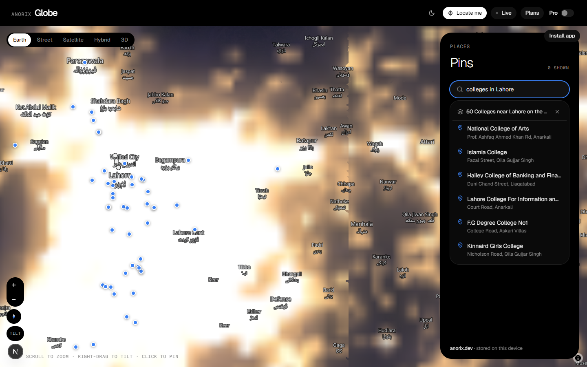

# Anorix Globe

A live 3D Earth you can search, pin and explore, from space down to street level, with no API keys. Search any place, address or category: "schools in Lahore", "universities in Tokyo", "hospitals near me" drops every match on the map.



## Features

- **Five map modes.** Earth (Esri imagery, terrain, hillshade and live day/night with NASA Black Marble city lights), Street, Satellite, Hybrid and 3D buildings with terrain.
- **Search everything.** Places, towns and villages (Nominatim, Photon and GeoNames, merged and ranked).
- **Category search.** Schools, colleges, universities, education, hospitals, clinics, pharmacies, restaurants, cafes, hotels, mosques, banks, ATMs, fuel, parks, malls, police, stations, airports and more. Works with a named city ("colleges in Faisalabad"), the current map view ("schools") or your location ("restaurants near me"). Results come from the OpenStreetMap Overpass API, with Photon and Nominatim as fallbacks when Overpass is busy.
- **Pins.** Drop, edit, rate and share pins. Free shares are rounded to about 1 km; Pro (a local demo, no payment) adds private pins, live location and custom rating criteria.
- **Installable PWA**, light and dark themes, keyboard navigation in search.

## Run locally

Requires Node.js 20 or newer.

```bash
npm install
npm run dev          # http://localhost:3000
```

Production:

```bash
npm run build
npm start
```

## How search works

- `GET /api/geocode?q=…` — place search (Nominatim + Photon + Open-Meteo/GeoNames), cached for 10 minutes.
- `GET /api/places?q=schools%20in%20Lahore` — category search. Optional `bbox=w,s,e,n` (map view) or `lat`/`lng` (near me). Category words are in [`lib/categories.ts`](lib/categories.ts). Nominatim is called at most once per second per its usage policy.

## Data sources and credits

| What | Source | License |
| --- | --- | --- |
| Map data, places, categories | © [OpenStreetMap](https://www.openstreetmap.org/copyright) contributors via Overpass API, Nominatim and [Photon](https://photon.komoot.io) (komoot) | ODbL 1.0 |
| Vector basemap | [OpenFreeMap](https://openfreemap.org) Liberty style, OpenMapTiles schema | ODbL data, BSD/CC-BY style |
| Satellite imagery | Esri World Imagery (Esri, Maxar, Earthstar Geographics, GIS User Community) | Esri terms of use |
| Terrain | [AWS Terrain Tiles](https://registry.opendata.aws/terrain-tiles/) (Terrarium) | Open data, see registry |
| Night lights | NASA Black Marble via [GIBS](https://earthdata.nasa.gov/gibs) | NASA public data |
| Small-town names | GeoNames via [Open-Meteo Geocoding](https://open-meteo.com/en/docs/geocoding-api) | CC BY 4.0 |
| Boundaries shading | Natural Earth | Public domain |

Attribution is shown on the map (ⓘ in the corner).

## Stack

Next.js (App Router), React, TypeScript, Tailwind CSS, shadcn/ui, MapLibre GL JS (globe projection).

## License

Code © 2026 Ahsan Javed / [Anorix](https://anorix.dev). All rights reserved unless a license file says otherwise. Map data and imagery keep their own licenses listed above.
